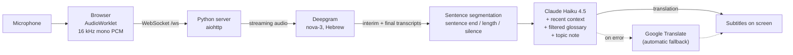

# Hebrew → Spanish Live Subtitles

Real-time subtitles for spoken Hebrew: streaming speech-to-text with Deepgram, sentence-level translation with Claude Haiku 4.5, and automatic fallback to Google Translate.

## What it does

I built this to follow a Hebrew-language football analytics course taught in person. A small Python server listens to the laptop microphone through the browser, transcribes the Hebrew as it is spoken, and shows each sentence translated into Spanish (or English) on a local web page, with the original Hebrew underneath.

The page (`index.html`, served at `http://localhost:8765`) has:

- **Start / Pause / Stop.** While paused, no audio is sent to the speech service.
- **Microphone picker**, so you can use an external mic.
- **Target language:** Spanish or English.
- **Translator:** Claude or Google, switchable mid-session without restarting.
- **Font size** sliders for the translation and the Hebrew, plus a toggle to hide the Hebrew.
- **Dark mode.**
- **Save transcript:** downloads a `.txt` file with each Hebrew line and its translation.
- **Audio sent** counter, showing how much audio has been streamed.
- **Live partial transcript:** the sentence in progress appears in grey before it is translated.

## Demo

<!-- TODO: add a short GIF or video, e.g.  -->
_Demo GIF coming soon._

## Architecture



1. The browser captures the microphone and an **AudioWorklet** downsamples it to 16 kHz mono 16-bit PCM, sending ~100 ms chunks to the server over a WebSocket.
2. The server ([server.py](server.py)) forwards the audio to **Deepgram** (`nova-3`, language `he`) over a streaming WebSocket, with interim results enabled. Keep-alive messages hold the connection open while paused, and the server reconnects with backoff if Deepgram drops.
3. **Segmentation:** final transcript fragments are accumulated and flushed as one subtitle line when
   - the text ends a sentence (`.`, `?`, `!`, `…`) and is at least `MIN_LINE_CHARS` long, or
   - it exceeds `HARD_LINE_CHARS` without punctuation, or
   - the speaker has been silent for `SILENCE_FLUSH` seconds.
4. Each line goes through a single ordered queue to the translator, so translations always arrive in order.
5. **Claude Haiku 4.5** translates the line with the previous sentences as context, the glossary entries that match it and a short "what are we talking about" note.
6. If Claude fails (errors, rate limits, no credit), the server switches to **Google Translate**, tells the user once in the status bar, and tries Claude again after 60 seconds.

## Design decisions

- **Separate speech errors from translation errors.** Every subtitle shows the Hebrew transcript under the translation, and `DEBUG_LOG=1` writes a `debug.log` with what Deepgram returned (interim and final), each flushed line and the topic notes. Looking at real sessions this way shows whether a bad subtitle came from a mis-heard word or a bad translation, which decides what to fix: the glossary, the prompt or the speech settings.
- **A small model with context instead of a big model.** Claude Haiku 4.5 at temperature 0 receives the last `CONTEXT_LINES` (5) sentences. Only the last `CONTEXT_HE_LINES` (2) include the Hebrew; older ones are sent as translation only, because Hebrew uses many more tokens. Every `TOPIC_EVERY` (40) translated sentences, Claude writes a 1–2 sentence topic note that goes along with the following requests. This helps it fix mis-transcribed names and terms. The system prompt tells it to keep the football meaning of ambiguous words, never swap one player's name for another and mark untranslatable fragments as `[…]` instead of inventing content.
- **A glossary filtered per sentence to control cost.** [glosario.txt](glosario.txt) maps Hebrew terms (including common mis-transcriptions) to Spanish. Instead of sending the whole file with every request, only entries whose key appears in the current sentence or its recent context are included, up to 40 per request. Hebrew final letters are normalised so that inflected forms still match.
- **Fallback when a provider fails.** Claude calls retry briefly on 429/5xx errors. If they still fail, Google Translate takes over for 60 s, so the subtitles keep going.
- **Optional extras, off by default.** A second pass (`REFINE=1`) re-translates each sentence once the following ones are known and updates the screen. Live partial translations (`LIVE_ENABLED=1`) translate the sentence in progress. Both cost more, so they are disabled.
- **Tests with mock servers.** [test_pipeline.py](test_pipeline.py) runs the real server against local fake Deepgram, Claude and Google endpoints. No internet access or real keys are needed.

## Requirements

- Python 3.9+ and Google Chrome (the page uses `AudioWorklet` and `getUserMedia`).
- API keys from these **paid third-party services** (each bills by usage; check their current pricing):
  - [Deepgram](https://console.deepgram.com): speech-to-text. **Required.**
  - [Anthropic](https://console.anthropic.com): Claude API, for the main translator. This is separate from a Claude.ai subscription.
  - [Google Cloud Translation API](https://console.cloud.google.com): optional, used as the fallback or as the only translator. It needs a Google Cloud project with the Cloud Translation API enabled and an API key (ideally restricted to that API).

You need the Deepgram key plus at least one translator key. With only the Anthropic key there is no fallback.

## Setup

```bash
git clone https://github.com/aschwartz97/hebrew-spanish-live-subtitles.git
cd hebrew-spanish-live-subtitles

python3 -m venv .venv
source .venv/bin/activate
pip install -r requirements.txt

cp .env.example .env
# edit .env and paste your keys; set TRANSLATOR=claude to use Claude
```

`.env` is listed in `.gitignore`. Never commit it.

Run the server:

```bash
python server.py
```

Open http://localhost:8765 in Chrome, click **Iniciar** (Start) and allow microphone access. The server only listens on `127.0.0.1`.

On macOS, `translator.command` starts the server and opens Chrome in one double-click (run `chmod +x translator.command` once).

> The UI and the translation prompts are in Spanish.

### Optional class context

Two optional files add context to the translation prompt. If they do not exist, everything works the same without them.

| File | Purpose | Template |
|---|---|---|
| `ficha.txt` | Fixed notes about the class: general topics, frequent names and terms (sent with every sentence, capped at 1500 characters). | [ficha.example.txt](ficha.example.txt) |
| `calendario.txt` | One line per date, `YYYY-MM-DD \| topics \| teacher`. Only today's line is sent. | [calendario.example.txt](calendario.example.txt) |

Copy a template without `.example` and edit it. Both real files are in `.gitignore`. You can also point to other paths with `FICHA_FILE` and `CALENDAR_FILE`.

### Configuration

All settings are environment variables, read from `.env`:

| Variable | Default | Meaning |
|---|---|---|
| `DEEPGRAM_API_KEY` | none | Deepgram key (required) |
| `ANTHROPIC_API_KEY` | none | Claude API key |
| `GOOGLE_TRANSLATE_API_KEY` | none | Google Cloud Translation key (fallback) |
| `TRANSLATOR` | `claude` if an Anthropic key exists, else `google` | Initial translator |
| `CLAUDE_MODEL` | `claude-haiku-4-5` | Claude model |
| `DEEPGRAM_MODEL` / `DEEPGRAM_LANGUAGE` | `nova-3` / `he` | Speech model and language |
| `MIN_LINE_CHARS` / `HARD_LINE_CHARS` | `120` / `350` | Segmentation thresholds |
| `SILENCE_FLUSH` | `4.0` | Seconds of silence before flushing a line |
| `CONTEXT_LINES` / `CONTEXT_HE_LINES` | `5` / `2` | Previous sentences sent as context / with Hebrew |
| `TOPIC_EVERY` | `40` | Sentences between topic-note updates (`0` = off) |
| `REFINE` | `0` | Second translation pass |
| `LIVE_ENABLED` | `0` | Live partial translations |
| `DEBUG_LOG` | `0` | Write `debug.log` |
| `PORT` | `8765` | Local port |

`.env.example` has the variables that are most often changed.

## Tests

```bash
source .venv/bin/activate
python test_pipeline.py claude     # Claude translator: segmentation, order, context, glossary filtering, pause, auth headers
python test_pipeline.py google     # Google translator
python test_pipeline.py fallback   # Claude fails -> Google takes over, user is notified once
python test_pipeline.py extras     # topic note, optional class context (ficha.example.txt) and second pass
```

Each mode starts fake Deepgram, Claude and Google servers on `127.0.0.1` and drives the real server through its WebSocket.

## Limitations

- **Noisy audio hurts.** Room echo, distance from the speaker, cross-talk and music all degrade the transcription, and the translation cannot recover words that were never recognised.
- **Proper names are hard.** Player, coach and club names are often mis-transcribed. The glossary and context help, but some names still come out wrong.
- **There is a delay of a few seconds.** A line is translated only after a sentence ends or the speaker pauses, so subtitles trail the speaker.
- **It helps, it does not replace learning the language.** Translations can be wrong or miss nuance. Use it as support, not as an authoritative transcript.

## Disclaimer

Personal project, not affiliated with any speech, translation or education provider. Contains no course material. Recording other people's audio may require their consent: check the rules where you use it and ask the speaker first.

## License

[MIT](LICENSE) © 2026 Ari Schwartz
